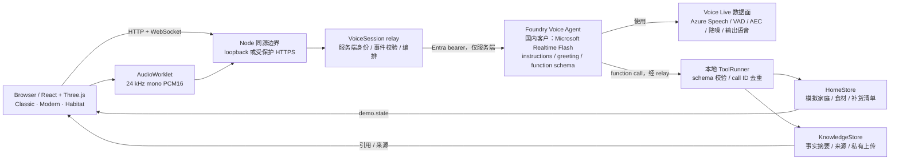
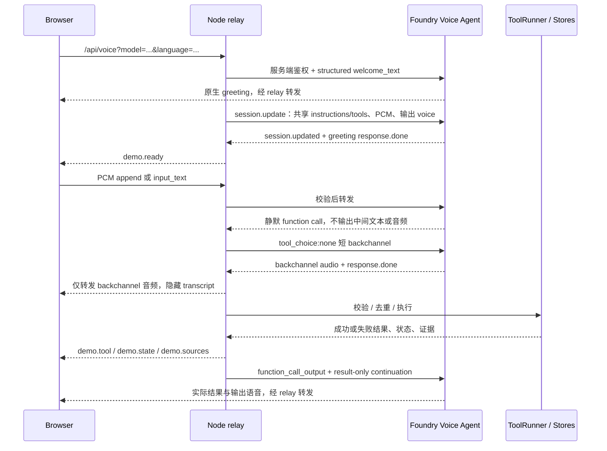
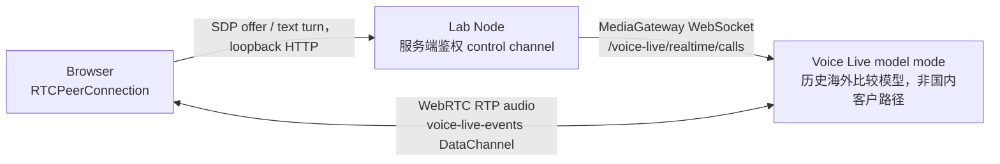
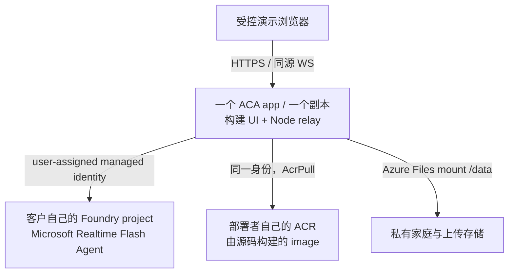

# 架构与安全边界

## 两个不同层次

**Voice Agent → 使用 → Voice Live**，二者不是别名。
Foundry Agents service 创建、配置、版本化 Voice Agent，保存模型选择、instructions、
语音配置和工具定义；Voice Live 是实际处理语音输入输出、转录、VAD 和音频流的实时数据面。
本应用的 Node 服务不是另一只 Hosted Agent，而是拥有本地工具执行权的 relay。



三个 UI 共享一个 API、家庭协议、音频实现和工具集。Modern 提供 Habitat 复用的组件和场景构件；
它不是复制一份后端。相机、材质与视觉效果只改变展示，不赋予浏览器额外工具权限。
所有房间几何和材质都由源码生成，不依赖外部 CAD、CDN 字体或私有编译镜像。

## 浏览器与 Node 的边界

浏览器可以发送受限的用户文本、PCM、取消/提交和合法音频截断事件，
不能选择任意 upstream endpoint、覆盖系统 instructions、改写工具 schema、提供 function output，
也不能自称设备已成功改变。HTTP 与 WebSocket 都验证同源及 Host。
请求体、音频帧、队列背压和 session 生命周期有界；错误通过 UI 和服务端日志显式呈现。

语音身份在服务端获得：本地是 `AzureCliCredential`，云端是 `ManagedIdentityCredential`。
`attachVoice()` 为一个应用实例构造一次 `VoiceDependencies`，后续 session 复用 credential/token cache，
不是每次连接重新构造 managed-identity credential。token 不返回浏览器，也不写入源码/日志。
session metadata 不直接透传，原始服务错误被替换为不含 token/内部配置的错误提示。

本地只允许 loopback；两个独立 UI 的 Vite proxy 先验证原始请求 origin，再重写到固定 loopback backend。
它们是开发便利设施，不是云端认证。云端不运行 Vite，通过 Node 提供构建静态资源和同源 API。

## WebSocket 数据流



`demo.ready` 同时依赖配置确认和 greeting 完成，避免首个用户请求与欢迎语重叠。
UI 语言只决定欢迎语和界面；转录候选语言固定为 `zh-CN,en-US`，实际回答跟随用户。
切换模型会结束旧 session，不假装把旧上下文迁移到新模型。

## speech profile 和工具前后编排

客户 Flash 模板使用以下可审阅 profile；必须在客户实际项目中验证兼容性：

| 项目            | 值                                                                                     |
| --------------- | -------------------------------------------------------------------------------------- |
| 输入 / 输出编码 | `audio/pcm`，`rate: 24000`，浏览器单声道 PCM16                                         |
| AEC             | `server_echo_cancellation`，`reference_source: server`，`channels: 1`                  |
| 降噪            | `azure_personal_noise_suppression`，`detection_input: mas_dns`                         |
| 转录            | `azure-speech-streaming`，`language: zh-CN,en-US`                                      |
| 动态 VAD        | `azure_semantic_vad`，`profile: normal`                                                |
| 回合行为        | `auto_truncate/create_response/interrupt_response: true`，`remove_filler_words: false` |
| 输出 voice      | `zh-CN-Xiaoxiao:DragonHDFlashLatestNeural`                                             |

动态 VAD 在托管语音数据面执行，不是前端关键字触发器，也没有额外添加 speech-start classifier
或 endpointing model 来改变这份配置。relay 不在每次 `session.update` 重写 VAD/降噪/转录；
因此必须先正确发布 Agent，不能只靠连接时覆盖来补齐缺失配置。

instructions 要求工具前模型只输出 function call，不说中间文本或音频，禁止长过程说明。
`VoiceSession` 在 `response.done` 收集并去重 call；若 response 没有 spoken output，
用 call ID 稳定选择“好 / 收到 / 嗯，好 / 可以”，英语为 “Sure.”，请求一次禁用工具的 backchannel response。
backchannel 的音频正常转发，但 `audio_transcript/output_audio_transcript/text/output_text`
的 delta/done 事件被隐藏，不在聊天中生成额外消息；后续完成回答恢复正常 transcript 转发。
收到完成后才执行 pending calls，再通过只允许讲话的 continuation 汇报工具结果。
取消/失败会丢弃 pending calls，不执行被取消的动作。单元测试覆盖 fallback、音频转发和全部 transcript 变体隐藏、
后续回答恢复、重复 call、取消、首轮 greeting 和 continuation 顺序。
对旧模型已主动说出的 acknowledgement 保留兼容调度；新的 instructions 不再请求这一行为。
协议层还跟踪 `response.output_item.added`：同一 response 已出现 message，随后又出现
function_call 时，relay 发出 `demo.discard-assistant-output` 并携带待移除的 item IDs。
三个 UI 共用的 VoiceClient 立即停止排队音频、移除对应 transcript；relay 抑制这些 item
后续的音频和文本 delta/done，当前 response 结束后清理跟踪状态。
工具完成后的新消息不受影响，已有其他回合的消息也不会被删除。
已经通过扬声器播放的前缀无法撤回，不能把此机制描述为绝对没有听到过过程话语。

这是确定的调度策略，不是硬编码的用户意图解析器；输出仍由真正的 Voice Agent 生成。
成功语句必须基于实际工具结果，失败不能被模型描述成成功；源代码不能保证每个声学环境下的主观体验。

## 工具与知识

`ToolRunner` 独占设备控制、场景、食品记录、清单编辑和文档检索入口。
Zod 和共享控制范围验证输入，call ID 缓存避免单 session 重复执行。
HomeStore 保存 revision，变更通过订阅推送给浏览器；UI 只投影权威状态。
冷暖温度设定不会自动改变录制的环境值，食品记录不是摄像头识别。

`KnowledgeStore` 提供有界文本检索，而不是生产级 vector database / RAG pipeline。
基础知识区分制造商事实、demo 说明、带日期推荐以及用户上传。
上传文档只当证据，不当系统指令；产品问题应检索、引用、说明事实缺口，不捏造保修或认证。
不存在真实 IoT、视频内容分发、海尔账号、购物结算或付款集成。

## 持久化与隔离

本地模式共用 `.azure/home.json` 和 `knowledge/uploads/`，多个 tab/edition 是同一家庭。
不要将 loopback 模式暴露到共享网络。云模式为随机浏览器 session 创建家庭目录，
文件名只能来自已验证的签名 cookie，而不是任意客户端路径：

```text
<HAIER_DATA_PATH>/
  <random-session-id>/
    home.json
    uploads/
```

cookie 使用 HMAC、12 小时到期、HttpOnly、Secure、SameSite=Lax 和 `__Host-` 前缀。
一个实例最多 100 个家庭；过期 cookie 不等于自动删除磁盘数据，清理和保留期限需要部署者另行管理。
新浏览器/签名密钥变化会失去原 session，访问码本身不是跨设备身份。
默认单副本：文件存储不是分布式事务数据库，多副本写同一个 JSON 会破坏一致性。
模型侧默认 `store: false`，实际数据处理仍遵循服务配置与合规要求。

## WebRTC model-mode lab



lab 不连接 Foundry Agent、不带家居工具、知识库、家庭存储或正式 demo 的 pre/post-tool 流程。
每轮只记录第一个 `output_audio_buffer.started`；这是事件到达时间，不是实际 DAC/扬声器出声时间。
浏览器 ICE/STUN 和网络条件会影响测量。服务只绑定 loopback，有 session 数和时间上限；
没有生产用户鉴权，不能直接拿它作为公共 WebRTC 服务。

## 部署拓扑



默认 `HAIER_MIN_REPLICAS=1` 避免 scale-to-zero 冷启动，可显式设为 `0` 节约闲置费用；
这不能消除模型、凭据、网络等其他启动开销。manifest generator 不查询或部署 Azure，
不会创建 RBAC 或使用预置 subscription/tenant/resource。
生产用途需补齐身份认证、滥用防护、预算与监控，而不是仅启用 guest cookie。
