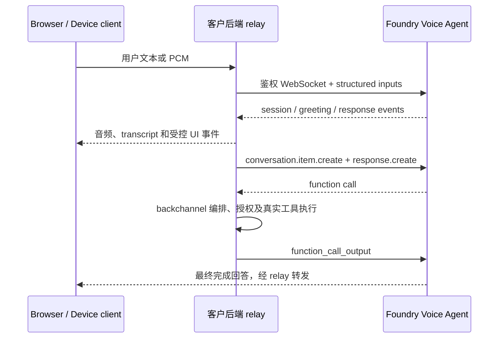
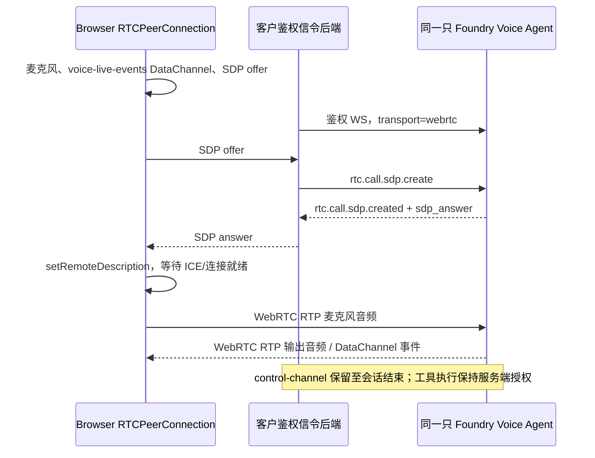

# 客户接入指南：部署 Agent、API 对话与真实设备工具

本文按三个步骤组织：

1. 在客户自己的 Foundry project 中部署、配置 Realtime / Mini Voice Agent。
2. 通过 WebSocket 或 WebRTC 与**同一只已保存的 Voice Agent** 对话。
3. 把工具执行连接到真实设备，选择直接设备 API 或 MCP。

**Voice Agent 使用 Voice Live，但不等于 Voice Live。**
本指南的对话入口是 Foundry Agent endpoint，而不是直接指定模型的 Voice Live endpoint。
所有命令中的资源值都由客户提供；本文不包含预置资源、访问密钥或部署结果。
示例命令仅供操作者审阅后执行，不会因为阅读或构建样例而触发部署。

## 第 1 节：部署和配置 Voice Agent

### 1.1 前置条件与身份

准备 Node.js 24.5+、npm、Azure CLI，以及自己的 Foundry resource / project。
确认目标项目支持 `gpt-realtime-2.1`、`gpt-realtime-2.1-mini` managed 模型、
Azure Speech streaming transcription 和本指南的 speech profile。
区域支持、访问资格及配额需在客户项目中确认，不能从一个演示项目的成功推断其他项目也可用。

`model_type: managed` 使用服务管理的模型，不是客户 Azure OpenAI deployment 的名字。
如果选择 self-deployed 模式，则需另行准备支持的 model deployment，并调整模型绑定；
不能只把一个 deployment 名字填入 managed 模板。

管理身份需要读取、创建/更新及按需启用 Agent 的项目权限；运行身份仅需调用权限。
根据实际角色定义，使用 `Foundry Agent Developer` / `Foundry Agent Consumer` 等项目级角色。
不要为运行服务授予订阅级 Owner，不要把资源 API key 或 Entra token 放进浏览器。

```bash
# 以下变量均替换为客户自己的值。不要把填好的脚本或 .env 提交到 Git。
export AZURE_TENANT_ID="<your-tenant-id>"
export AZURE_SUBSCRIPTION_ID="<your-subscription-id>"
export FOUNDRY_PROJECT_ENDPOINT="https://<resource>.services.ai.azure.com/api/projects/<project>"
export HAIER_REALTIME_AGENT="<your-realtime-agent-name>"
export HAIER_MINI_AGENT="<your-mini-agent-name>"

az login --tenant "$AZURE_TENANT_ID"
az account set --subscription "$AZURE_SUBSCRIPTION_ID"

# 从仓库根目录进入样例；此前已在该目录时不要重复 cd。
cd samples/haier-voice-home
npm ci
```

`az account set` 选择管理订阅；Agent authoring 和对话仍以
`FOUNDRY_PROJECT_ENDPOINT` 指定的项目为准，必须核对二者对应关系。
本地使用 `AzureCliCredential`，生产环境推荐应用自己的 managed identity。
资源创建、网络隔离和 RBAC 分配应按客户基础设施流程办理，本指南不自动 provision。

### 1.2 可审阅的 Agent YAML

下面用 YAML 展示两个 Agent 的配置结构。`instructions` / `tools` 的空值与源码基础模板一致，
**不是可直接发布的完整定义**；下一步会从共享源码填入，避免维护两套相互矛盾的指令和工具。
`structured_inputs` 与 greeting 也由同一个 materializer 生成。
部署 API 接收 JSON；不能把 YAML 文件直接作为 `az rest --body` 上传。

```yaml
realtime: &voice_agent
  kind: voice
  model: gpt-realtime-2.1
  model_type: managed
  sub_protocol: realtime
  instructions: "" # 由 server/instructions.ts 和 instructions.txt 填入
  tools: [] # 由 server/tools.ts 填入完整 function schema
  store: false
  output_modalities: [audio, text]
  structured_inputs:
    welcome_text:
      description: Initial welcome only; speech recognition remains bilingual.
      schema:
        type: string
        minLength: 1
        maxLength: 200
      default_value: 你好，我是小海，你的家庭助手。今天想让我帮你做点什么？
  greeting:
    type: template
    text: "{{{welcome_text}}}"
  audio:
    input:
      format:
        type: audio/pcm
        rate: 24000
      echo_cancellation:
        type: server_echo_cancellation
        reference_source: server
        channels: 1
      noise_reduction:
        type: azure_personal_noise_suppression
        detection_input: mas_dns
      transcription:
        model: azure-speech-streaming
        language: zh-CN,en-US
      turn_detection:
        type: azure_semantic_vad
        profile: normal
        auto_truncate: true
        create_response: true
        interrupt_response: true
        remove_filler_words: false
    output:
      format:
        type: audio/pcm
        rate: 24000
      voice: zh-CN-Xiaoxiao:DragonHDFlashLatestNeural
      voice_type: azure-standard

mini:
  <<: *voice_agent
  model: gpt-realtime-2.1-mini
```

权威源码是 `agents/realtime.json`、`agents/mini.json`、
`server/voice-profile.ts`、`server/greeting.ts`、`server/instructions.*` 和 `server/tools.ts`。
实际中英文 greeting 默认值以 `server/greeting.ts` 展开结果为准。
用户界面语言决定首次 welcome_text，不把后续识别或回答锁成单语。

### 1.3 生成完整定义

```bash
# 完全离线，不查询或修改 Azure。
npm run agents:render

# 将展开后的两个定义包装为 authoring API 的 request body。
node --input-type=module <<'NODE'
import { readFileSync, writeFileSync } from "node:fs";
const definitions = JSON.parse(
  readFileSync(".local/agent-definitions.json", "utf8"),
);
for (const edition of ["realtime", "mini"]) {
  writeFileSync(
    `.local/${edition}.request.json`,
    `${JSON.stringify({ definition: definitions[edition] }, null, 2)}\n`,
    { mode: 0o600 },
  );
}
NODE
```

检查 `.local/*.request.json`：必须包含完整 instructions、全部工具、greeting、音频和 VAD。
`store: false` 是 fresh template 的默认选择；若更新已有 Agent，要审阅已有 recording/数据保留配置。
`.local/` 被 Git 和 Docker context 排除，但本地文件仍应妥善保管。

### 1.4 发布：优先使用带保护的脚本

```bash
npm run agents:publish -- \
  --confirm-project "$FOUNDRY_PROJECT_ENDPOINT"
```

脚本要求显式 endpoint 和两个不同的 Agent 名字，拒绝示例占位符。
新建和更新均使用 named Agent version endpoint；更新已有 Agent 时保留未知/Portal-owned 字段，
拒绝改变 kind/model/model_type，发布前检查版本变化，发布后逐字段 readback。
两只 Agent 顺序发布，不是原子事务；第二只失败不会回滚第一只。
并发检查也不是服务端 compare-and-swap，应协调独占发布窗口。

### 1.5 等价的 `az rest` 发布与 readback

以下是**人工管理版本的底层方式**，与上一小节二选一，不要连续重复发布。
它展示 API，不带脚本的 Portal 字段合并和并发保护：直接上传基础模板会重置未携带的设置。
对已有 Agent，优先使用上面的脚本；只有审阅完整 definition 后才使用此方式。

```bash
export AUTHORING_API_VERSION="2025-11-15-preview"

az rest --method post \
  --url "$FOUNDRY_PROJECT_ENDPOINT/agents/$HAIER_REALTIME_AGENT/versions?api-version=$AUTHORING_API_VERSION" \
  --resource "https://ai.azure.com" \
  --headers "Content-Type=application/json" "Foundry-Features=VoiceAgents=V1Preview" \
  --body @.local/realtime.request.json \
  --query "{version:version,status:status}" --output json

az rest --method post \
  --url "$FOUNDRY_PROJECT_ENDPOINT/agents/$HAIER_MINI_AGENT/versions?api-version=$AUTHORING_API_VERSION" \
  --resource "https://ai.azure.com" \
  --headers "Content-Type=application/json" "Foundry-Features=VoiceAgents=V1Preview" \
  --body @.local/mini.request.json \
  --query "{version:version,status:status}" --output json

# 导出实际保存的完整定义为 YAML，而不是只查看本地模板。
az rest --method get \
  --url "$FOUNDRY_PROJECT_ENDPOINT/agents/$HAIER_REALTIME_AGENT?api-version=$AUTHORING_API_VERSION" \
  --resource "https://ai.azure.com" \
  --headers "Foundry-Features=VoiceAgents=V1Preview" \
  --query "versions.latest" --output yaml > .local/realtime.saved.yaml

az rest --method get \
  --url "$FOUNDRY_PROJECT_ENDPOINT/agents/$HAIER_MINI_AGENT?api-version=$AUTHORING_API_VERSION" \
  --resource "https://ai.azure.com" \
  --headers "Foundry-Features=VoiceAgents=V1Preview" \
  --query "versions.latest" --output yaml > .local/mini.saved.yaml
```

核对版本、`status`、精确模型及 advanced audio 字段。若目标项目的 Agent 被禁用，
在确认需要开放该 Agent 的调用后，按服务的启用流程处理；仓库现有 stable-v1 参考使用：

```bash
# 仅在需要时由有权限的操作者执行；这会改变目标 Agent 的可调用状态。
az rest --method post \
  --url "$FOUNDRY_PROJECT_ENDPOINT/agents/$HAIER_REALTIME_AGENT:enable?api-version=v1" \
  --resource "https://ai.azure.com" \
  --headers "Foundry-Features=VoiceAgents=V1Preview"
```

Mini 同理，替换为自己的 Mini Agent 名字。authoring 示例沿用本样例发布脚本的 preview contract；
对话使用 `api-version=v1`。启用示例来自仓库 stable-v1 reference。
服务不接受某版本或字段时应检查对应服务文档，不要删除字段或改用其他协议来伪装成功。
最后在 `.env` 中配置 endpoint、两只 Agent 名字，并在实际验证后设置：

```dotenv
HAIER_VERIFIED_MODELS=gpt-realtime-2.1,gpt-realtime-2.1-mini
```

此变量是应用开关，不是自动测试报告。发布成功不代表模型推理、音频、设备工具都已接通。

## 第 2 节：通过 API 与 Voice Agent 对话

### 2.1 共同的鉴权与 endpoint

两种传输都选择 Agent **name**，不是模型名、旧 assistant ID 或资源 ID。
同一个 Realtime / Mini Agent 可以通过对应项目支持的传输建立新 session。
token 由受信任后端取得，scope/resource 是 `https://ai.azure.com`：

```bash
# 仅供服务端调试；不要 echo、写入 URL、提交或发送给浏览器。
TOKEN="$(az account get-access-token \
  --resource https://ai.azure.com \
  --query accessToken --output tsv)"
# 使用后清理当前 shell 变量。
unset TOKEN
```

实际 Node 服务优先使用 Azure Identity SDK，不让脚本反复获取 token。
生产场景使用应用身份；用户/家庭/设备权限仍由客户应用单独判断，服务 token 不等于最终用户授权。
不要把长期凭据硬编码到浏览器 WebSocket subprotocol、DataChannel、日志或 localStorage。

### 2.2 WebSocket：音频与事件经后端转发

```text
wss://<resource>.services.ai.azure.com/api/projects/<project>/agents/<agent-name>/endpoint/protocols/voice?api-version=v1
```

后端握手使用 `Authorization: Bearer <server-acquired-token>`。
可增加 `agent_session_id=<unique-id>`，通过 URL 编码的 `structured_inputs`
传入 `{"welcome_text":"你好，我是小海，你的家庭助手。今天想让我帮你做点什么？"}`。
这些参数不是浏览器可任意覆盖 instructions/tools 的通道。
如需复现固定版本，按服务支持的 `x-agent-version-override` 选择经验证的版本，
不要把另一个 Agent 的版本号直接套用。



**文本输入**由两个 JSON frame 组成：

```json
{
  "type": "conversation.item.create",
  "item": {
    "type": "message",
    "role": "user",
    "content": [{ "type": "input_text", "text": "请打开电视。" }]
  }
}
```

```json
{ "type": "response.create" }
```

**音频输入**使用 base64 编码的原始 PCM16 little-endian，24 kHz mono，
不是 WAV 文件、MP3 或 WebM。下面的值只是两个静音样本的 wire-format 示例：

```json
{ "type": "input_audio_buffer.append", "audio": "AAAAAA==" }
```

连续实时发送合理长度的分片。使用自动 VAD 时由服务管理回合，不要对每个分片重复 commit/create。
非自动模式才按该模式的协议提交缓冲区。浏览器采样率可能是 48 kHz，必须正确重采样；
不能只把 metadata 写成 24 kHz。现成实现见 `src/lib/capture-worklet.ts`、`audio.ts` 和 `pcm.ts`。

关键返回事件：

| 事件                                                                 | 客户端职责                                                        |
| -------------------------------------------------------------------- | ----------------------------------------------------------------- |
| `session.created` / `session.updated`                                | 核对 session；配置确认不等于 greeting 已结束                      |
| `response.audio.delta` / `response.output_audio.delta`               | base64 解码，按协议采样率排队播放 PCM                             |
| `response.audio_transcript.*` / `response.output_audio_transcript.*` | 增量与最终 assistant transcript                                   |
| `conversation.item.input_audio_transcription.completed`              | 用户语音转录                                                      |
| `response.function_call_arguments.done`                              | 在受信任后端按 allowlist 执行工具，不能直接交给浏览器执行任意命令 |
| `response.done`                                                      | 检查 completed/failed/cancelled，处理回合与工具 continuation      |
| `input_audio_buffer.speech_started`                                  | 处理打断，停止客户端已排队的旧输出                                |
| `error`                                                              | 显式失败、清理连接；不要回退为伪造回复                            |

工具返回使用与原 call 相同的 `call_id`：

```json
{
  "type": "conversation.item.create",
  "item": {
    "type": "function_call_output",
    "call_id": "<the-original-call-id>",
    "output": "{\"ok\":true,\"status\":\"succeeded\"}"
  }
}
```

随后由编排器发起需要的 `response.create`，避免与已有 response 重叠。
`ok: true` 必须来自真实执行结果，不能照抄示例伪造成功。
本样例还会在工具前生成短 backchannel、隐藏其 transcript，并在工具后只显示一条完成回答。
具体调度、取消、去重与错误处理见 `server/voice.ts` 和 `tests/server-voice.test.ts`。

**可直接运行的完整应用路径**：

```bash
# 在完成 Agent 配置的 samples/haier-voice-home/ 目录：
npm run dev
# 浏览器打开 http://127.0.0.1:5178，使用文字或麦克风交互。
```

浏览器连接的是应用自己的 `/api/voice?model=...&language=...`；
Node 把 allowlisted model 映射到保存的 Agent name，再打开上面的 Azure endpoint。
两层 URL 不能互换。外部应用复用 relay 时必须保持同源、认证和家庭隔离。

### 2.3 WebRTC：仍然调用同一只 Voice Agent

**Agent-mode WebRTC** 的服务端信令入口：

```text
wss://<resource>.services.ai.azure.com/api/projects/<project>/agents/<agent-name>/endpoint/protocols/voice?api-version=v1&transport=webrtc&agent_session_id=<unique-id>
```

token 同样留在后端。后端建立这个 WebSocket control-channel，浏览器通过客户应用自己的
鉴权信令接口交换 SDP；音频随后在浏览器与服务之间走 WebRTC RTP。
本节只讨论本样例的 Realtime / Mini Agent，不讨论 GPT Live 的另一套协议。



浏览器需要创建 `RTCPeerConnection`，加入麦克风 track，并在生成 offer **之前**创建
`voice-live-events` DataChannel；Realtime 的 SDP 需要相应的 SCTP/application media section。
按部署网络配置 STUN/TURN，等待 ICE gathering 完成或按服务支持的 candidate 流程处理。
SDP 经鉴权信令后端发送下面的 JSON，而不是 POST 到另一个 model-mode endpoint：

```json
{
  "type": "rtc.call.sdp.create",
  "sdp_offer": "<the-full-browser-local-description-sdp>"
}
```

接收：

```json
{
  "type": "rtc.call.sdp.created",
  "sdp_answer": "<the-service-sdp-answer>"
}
```

核心浏览器片段如下，展示 API 对接点，**不是独立可运行的完整客户端**：

```javascript
async function negotiateAgentWebRtc({
  iceServers,
  exchangeOffer,
  remoteAudio,
  onAgentEvent,
}) {
  const peer = new RTCPeerConnection({ iceServers });
  const microphone = await navigator.mediaDevices.getUserMedia({
    audio: { channelCount: 1, echoCancellation: true, noiseSuppression: true },
  });
  microphone.getAudioTracks().forEach((track) => {
    track.enabled = false; // 等媒体、配置和 greeting 就绪后才允许上传
    peer.addTrack(track, microphone);
  });
  const events = peer.createDataChannel("voice-live-events");
  events.onmessage = ({ data }) => onAgentEvent(JSON.parse(data));
  peer.ontrack = ({ streams }) => {
    remoteAudio.srcObject = streams[0];
  };
  await peer.setLocalDescription(await peer.createOffer());
  // exchangeOffer 必须有界等待 ICE gathering、使用完整 localDescription，
  // 通过客户已鉴权后端转发 rtc.call.sdp.create 并接收 sdp_answer。
  const answer = await exchangeOffer(peer);
  await peer.setRemoteDescription({ type: "answer", sdp: answer });
  return { peer, microphone, events };
}
```

`exchangeOffer`、就绪门控、超时/失败清理、自动播放用户手势和结束会话由客户实现。
在 ICE/配置/greeting 都就绪后才 enable track；失败或结束时关闭 peer/control-channel，
停止所有麦克风 track。WebRTC 的 codec/sample rate 由 SDP 协商，
不要把 RTP 当作 WebSocket 的 base64 PCM，也不要向 RTP 写入 JSON。

同一个 function tool 的执行权不会因为换成 WebRTC 自动迁到浏览器。
后端必须接收/处理相应 function events，并在受支持的 control/event 路径返回
`function_call_output`，保留 call ID、授权、去重和完成确认。
如果同一 event 在 control-channel 与 DataChannel 都可见，要选定权威事件源并去重，
不能执行两次动作。backchannel 的 transcript 若直接从 DataChannel 到达，
还需 UI 按后端提供的 backchannel response identity 过滤；
仅依赖现有 WebSocket relay 的过滤代码不能覆盖这条直达路径。

**仓库现状与可复用实现**：

| 路径                                                                    | 已提供什么 / 没提供什么                                                             |
| ----------------------------------------------------------------------- | ----------------------------------------------------------------------------------- |
| 本样例 `server/voice.ts`、三个 UI                                       | 已接通 Haier 的 WebSocket relay、家庭工具和 backchannel；没有接上 Agent-mode WebRTC |
| `../foundry_voice_webrtc/server.py` 的 `Config.voice_url()` / `relay()` | 同一个保存的 Agent 的 WebSocket/WebRTC endpoint 与信令参考                          |
| `../foundry_voice_webrtc/public/app.js` 的 `connectWebRtc()`            | SDP、ICE、麦克风、DataChannel 和远端音频参考                                        |
| 本样例 `server/webrtc-benchmark.ts`                                     | **直接 Voice Live model-mode lab**；不是这里的 Agent-mode 接入实现                  |

参考 sample 有自己的 Agent 创建/设置逻辑与业务场景，**不等于已装好 Haier 工具执行器**。
不要直接启动其 create/reset/apply-settings 流程去覆盖已保存的 Haier Agent。
客户若要在 Haier UI 切换 WebRTC，需要把信令、真实工具与 backchannel 编排一起接入并验收；
不能仅给当前 `/api/voice` 添加 `transport=webrtc` 就宣称完成。

Agent-mode、model-mode 和 Azure OpenAI 的 `/openai/v1/realtime/calls` 是不同入口，
不能混用 SDP 创建流程。GPT Live Agent 还使用另一条 `/voice/live/sessions` 路由及事件族，
不在本文两个 Realtime 模板的接入范围内。

## 第 3 节：把工具接到真实设备——直接 API 还是 MCP

### 3.1 MCP 不是接入真实设备的前提

当前调用链是：

```text
Voice Agent function call → Node VoiceSession → ToolRunner → HomeStore（模拟）
```

`HomeStore` 的成功只说明模拟家庭已保存，不能拿来证明真实设备动作完成。
第一步是准备客户设备平台/网关的 API、设备身份、功能清单、授权方式及真实状态回执；
是否封装 MCP 是后续架构选择。

| 方案                      | 链路                                                                    | 适用场景                                                                     |
| ------------------------- | ----------------------------------------------------------------------- | ---------------------------------------------------------------------------- |
| 直接 Function Tool        | Agent → relay/ToolRunner → DeviceAdapter → 客户设备 REST/MQTT/SDK/网关  | 推荐先完成一台设备闭环；复用现有 schema 和 UI 编排                           |
| relay 调用 MCP            | Agent function → relay → 受信任 MCP client → 设备 MCP server → 设备平台 | 希望复用现有 relay 的 backchannel/审计，同时把设备能力独立服务化             |
| Foundry 托管远端 MCP tool | Agent → 项目配置的 MCP connection/server → 设备平台                     | 多 Agent 共用工具或已有 MCP 平台；需验证该 Agent/model 的支持与审批/事件机制 |

无论选哪种，MCP 都不会自动提供真实设备驱动、租户权限、用户确认或设备执行证明。
本次交付**没有实现 DeviceAdapter 或真实设备 MCP server**，不应把模拟接口当作已有硬件集成。

### 3.2 推荐先完成直接设备 API 闭环

保留 `get_home_state`、`control_device` 等 allowlisted schema，
把执行实现从模拟 HomeStore 改为客户设备适配器。内部逻辑 `deviceId` 先解析为当前用户有权控制的
真实设备，不能让模型提供任意 URL、厂商 token、tenant ID 或网关指令。
读操作也必须校验所有权。

现有 `ToolRunner.run()`、状态存储和相关调用是同步实现；
远程网络操作需要改为异步，并同步调整 VoiceSession 的 pending-call、取消、超时和 continuation 调度。
**不能只在 `home.control()` 里发一个不等待结果的 HTTP 请求，然后沿用 `ok:true`。**

设备适配器至少应支持：

- 读取设备能力、在线状态、当前真实状态和状态时间戳；setpoint 与实际测量值分开。
- 根据真实型号校验能力/范围，不把 demo 的六种设备假设当成所有客户设备的通用协议。
- 使用 application-generated request ID / idempotency key 提交动作，关联查询或推送回执。
- 区分 `accepted`、`succeeded`、`failed`、`unknown`。收到 HTTP `200/202` 不必然说明设备已执行。
- 超时后先查询动作状态，不能盲目重复开锁、开机或触发其他不可重复动作。
- 将已确认的状态/失败回推 UI 与 Agent；真实设备模式不能在断连时静默回退到模拟成功。

可以设计如下内部执行结果，**这是客户适配器的示例协议，不是现有工具已实现的返回结构**：

```json
{
  "ok": true,
  "status": "succeeded",
  "requestId": "<application-generated-request-id>",
  "deviceId": "<authorized-device-alias>",
  "confirmedState": { "power": true, "temperature": 24 },
  "confirmedAt": "<device-or-platform-confirmation-time>"
}
```

只有 `succeeded` 且有可信回执时才能说“空调已经设为 24 度”。
`accepted` 只能说“指令已发送”，超时/`unknown` 应说“暂时无法确认是否执行”，并避免编造状态。
多设备场景不是天然事务：部分成功时必须报告实际结果，预先定义补偿或人工处理方式。

### 3.3 如果选择 MCP，需要另外准备什么

把业务能力封装成受控工具，例如 `get_device_state`、`set_climate`，
而不是向模型暴露 `execute_any_command` 或任意设备 URL。
MCP server 实现这些工具后仍需调用真实设备平台。
server 建议放在客户受控网络，使用支持的 MCP transport 和明确的服务端鉴权。
不要为了方便把设备 MCP 变成公开 no-auth 服务。

需要准备：

| 项目         | 要求                                                                                  |
| ------------ | ------------------------------------------------------------------------------------- |
| MCP 契约     | 工具 schema、能力边界、read/write 区分、版本兼容、业务错误及结果状态                  |
| 两跳身份     | Agent/relay → MCP 的服务身份；MCP → 设备平台的服务身份，分别管理最小权限              |
| 用户授权     | 从已验证应用会话取得 user/home context，服务端校验，不信任模型生成的 tenant/user 参数 |
| 设备平台连接 | 客户平台 API/MQTT/SDK、设备清单、状态订阅和可核验执行回执                             |
| 运维         | 幂等与审计、限流、网络策略、告警、紧急停止、密钥安全存储和轮换                        |
| 高风险动作   | 门锁、燃气、加热等由服务端策略和明确用户确认保护；模型 prompt 不是唯一防线            |

选择 Foundry 托管远端 MCP 时，在客户项目中创建对应的受保护 connection，
再把 MCP tool 绑定到 Agent。connection ID、凭据和实际 server endpoint
属于客户环境，不写进公共模板；具体字段以目标 API/SDK 版本为准。
仓库的 [`voice_agent_with_mcp.py`](../voice_agent_with_mcp.py) 展示
`VoiceAgentMcpTool` 与 `project_connection_id` 的接入方式。
不要照抄其中的免审批策略用于有风险的真实设备操作。

**托管 MCP 的执行不再经过现有本地 `ToolRunner`。**
现有本地 function call 的短 backchannel、transcript 隐藏、设备动态展示和完成确认
不会因此自动套用；需针对托管 MCP 的实际事件与审批生命周期另行接入和验收。
如果要最小化行为变化，可以先保留 function tool，让受信任 relay 内部调用 MCP。

### 3.4 客户联调与验收清单

建议先选一台空调完成闭环，再扩展其他设备和场景：

1. 客户提供测试设备、协议/SDK 文档、沙箱身份，以及型号能力与状态回执定义。
2. 只读查询：确认用户只能看到自己的设备，离线/陈旧状态不被说成实时事实。
3. 一次写操作：语音请求 → 参数/授权校验 → 短 backchannel → 提交命令 → 设备回执 → 单条完成回答。
4. 验证重复事件、超时、网络中断、设备拒绝、权限不足、用户取消及部分失败；不能重复执行或假报成功。
5. 在 WebSocket 与 Agent-mode WebRTC 分别验收工具顺序、打断、音频及 transcript 行为。
6. 上线前补齐用户认证、审计、限额/预算、告警、人工处理与数据保留；private Git 仓库不能替代运行时鉴权。

发布新定义后只影响新建立/相应版本的会话；不要把本地模板修改或单元测试通过当作客户设备接通。
本指南的 Azure 命令、Agent-mode WebRTC 和真实设备步骤未在客户环境执行，
必须由获授权操作者在隔离测试环境验证后才可用于真实用户。
