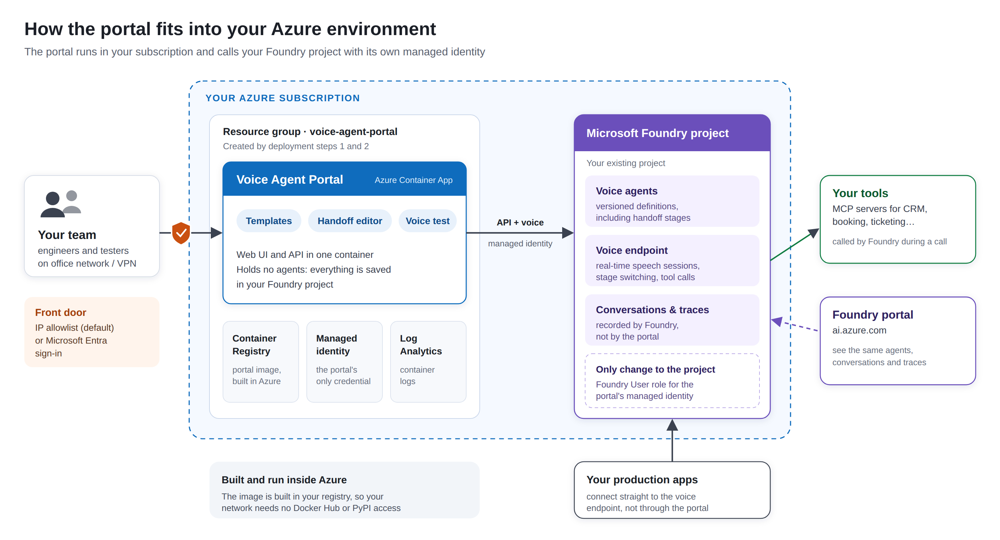

# Run the Voice Agent portal in your Azure subscription

The [Voice Agent portal](../../portal/README.md) runs on your own computer by default, and that stays the simplest way to use it: [run it locally](../../portal/README.md#run-locally). This guide is the **optional** alternative for teams that want one shared URL: the unchanged portal runs in an Azure Container App in **your own** subscription, connected to **your own** Foundry project, and only your office/VPN addresses (or, optionally, people who sign in with Microsoft Entra) can open it.

You do not need to know Azure. You run three commands in Azure Cloud Shell; the first one looks at what your account can see and do, asks you to choose where something is not clear, and saves your choices. The other two need no input. If a permission is missing, the scripts tell you what to ask for, from whom, and where they click.

## Before you start

| You need | Why | If you do not have it |
|---|---|---|
| A Foundry project with Voice Agents | The portal publishes and runs Agents there | Create one in the [Foundry portal](https://ai.azure.com) |
| **Contributor** on an Azure subscription (or on a resource group in it) | The portal's resources are created there | `prepare.sh` tells you, and names who can give it to you |
| Someone with **Owner**, **User Access Administrator** or **Role Based Access Control Administrator** on the Foundry project | They give the portal's own identity access to the project, once | You can still run all three commands; `deploy.sh` then writes the exact steps to send them |
| Your office or VPN public IP address range | Only these addresses can open the portal | Open any "what is my IP" page **in a browser on the office network or VPN**, or ask your network team. Not in Cloud Shell: that is an Azure address |

## Step 1: open Azure Cloud Shell

Open [https://shell.azure.com](https://shell.azure.com) and sign in with your work account. If it asks, choose **Bash**. If it asks about storage, the default choice is fine. Cloud Shell already has everything the scripts need.

## Step 2: choose the subscription

List the subscriptions you can use, then pick the one the portal should run in (copy its **Name** or **SubscriptionId** from the list):

```bash
az account list -o table
az account set --subscription "<Name or SubscriptionId>"
```

The Foundry project can be in a different subscription; you choose it in step 4.

## Step 3: get the scripts

```bash
git clone https://github.com/microsoft/voice-agent.git
cd voice-agent
```

## Step 4: prepare (checks and choices)

```bash
skills/portal-remote/scripts/prepare.sh
```

It finds the Foundry projects you can see and asks you to pick one (type part of a name to filter a long list), then asks who may open the portal (your office/VPN network, recommended, or people who sign in with Microsoft Entra) and, for the first, your office/VPN address ranges. The portal goes into a new resource group `voice-agent-portal` in the subscription of step 2, in the project's region (if Container Apps is not offered there, it asks for a region). It shows a plain summary and asks **Is this right? [Y/n]**. Nothing is created in this step.

Then it checks, before anything is created, everything the next two steps need, one line each:

- **PASS**: fine.
- **WARN**: the deployment can continue, but something will need someone else, for example an admin granting the portal's roles. The line says who and how.
- **FAIL**: fix this first. The line says what is missing, where to click in the Azure portal, and which people in your organization can do it. Then run `prepare.sh` again.

Your choices are saved in `portal/.env` in this folder, so you never type them again. Cloud Shell keeps this folder between sessions: if you come back later, `cd voice-agent` and continue with the next step. To change a choice, run `prepare.sh` again and answer **n** at **Is this right?**: it asks everything again.

## Step 5: build the portal image

```bash
skills/portal-remote/scripts/build.sh
```

It creates the resource group (if new) and a private container registry in it, and builds the portal image **inside that registry**. Nothing is downloaded into Cloud Shell. About two minutes.

## Step 6: deploy the portal

```bash
skills/portal-remote/scripts/deploy.sh
```

The first run takes about five minutes. If your organization requires Container Apps to use a virtual network, the script notices this and creates one for the portal, and the first run takes 10 to 25 minutes; most of it is Azure creating the environment, so let it run. It ends with a short summary, also saved to `~/voice-agent-portal.txt` so you can share it with your team (in Cloud Shell: **Manage files > Download**):

```text
Open it       : https://voice-agent-portal.<environment>.<region>.azurecontainerapps.io/editor/
How to get in : No sign-in. Open the address on a computer in your office or on your VPN.
Who can open  : Only browsers whose internet traffic comes from: 203.0.113.0/24
Check now     : running; this machine's IP is not in the allowlist (HTTP 403)
```

Below that it lists the limits (everyone who gets in shares the portal's identity; one copy runs) and the commands to change who can open it, upgrade, see logs, or remove it.

In Cloud Shell that **403 is the expected result**: Cloud Shell is not on your office network. Open the URL in a browser on your office network or VPN.

**If it stops and asks for an admin**: your account can create resources but cannot give the portal's identity its access (Contributor cannot grant roles; that is by design in Azure). The script prints the steps and saves them to `~/voice-agent-portal-admin-steps.txt` (in Cloud Shell: **Manage files > Download** to send it). The admin either clicks through the Azure portal as described, or pastes the `az role assignment create` lines into their own Cloud Shell. Only two roles are required; the two optional ones add the live voice list and the project picker. When they are done, run `deploy.sh` again; nothing is rebuilt.

To check the portal at any time, run `skills/portal-remote/scripts/status.sh`.

## Later

| To | Run |
|---|---|
| See whether it is running, and what is missing if not | `status.sh`. It changes nothing: it checks each resource the scripts create, the roles of the portal's identity, who can open it, and whether it answers. It ends with **Running** or the next command to run |
| Change who can open the portal | `prepare.sh`, answer **n** at **Is this right?** and choose again, then `deploy.sh` (the new address list replaces the old one) |
| Upgrade to a newer portal | `git pull`, then `build.sh`, then `deploy.sh` (settings and roles are kept; sessions in progress end) |
| Roll back | `git checkout <older version>`, then `build.sh`, then `deploy.sh` (it always runs the newest image) |
| See logs | In the Azure portal, open the Container App `voice-agent-portal` > **Monitoring > Log stream** |
| Remove the portal | In the Azure portal, open the resource group `voice-agent-portal` > **Delete resource group**. Agents in your Foundry project are **not** deleted. Remove the identity's leftover "Identity not found" role entries under **Access control (IAM)** on the project and the Foundry resource |

All scripts are in `skills/portal-remote/scripts/`; run them from the `voice-agent` folder.

## Who can do what

| | Local (default) | Container App + IP allowlist | Container App + Entra sign-in |
|---|---|---|---|
| Where it runs | Each person's own computer | One container in your subscription | Same |
| Who can open it | Only that computer | Anyone whose traffic comes from the address ranges you list | Users of your Microsoft Entra tenant who sign in |
| Identity used to call Foundry | Your own account | The container's managed identity, shared by everyone | Same |
| Good for | One or two people | A team on the office network or VPN | A team that also works off-network |

In both Container App options, everyone who gets in acts as the same managed identity: they can publish and delete Agents in your project and start sessions that incur cost, and the portal does not record who did what. Only let in people you would give that access to.



The browser talks only to the portal, and the portal calls your Foundry project with its managed identity. Agents you publish are stored in your project, so your own applications connect to an Agent's voice endpoint directly, and removing the portal does not affect them. The diagram's editable source is [`portal-container-apps-architecture.svg`](../../assets/portal-container-apps-architecture.svg).

## Add Microsoft Entra sign-in

Use this when people need the portal off your network, or only named people should get in. Run `prepare.sh`, answer **n** at **Is this right?**, choose **People in my organization who sign in with Microsoft Entra**, then run `deploy.sh`. It creates a single-tenant app registration with a one-year client secret, turns on sign-in, and then removes the IP rules. Creating an app registration needs permission in Microsoft Entra ID; without it, use the Azure portal steps below or ask an admin to do them.

In the Azure portal instead: open the Container App > **Security > Authentication** > **Add identity provider** > **Microsoft**, keep **Create new app registration** and **Current tenant - Single tenant**, keep **Require authentication**, and select **Add**. Only after sign-in works, remove the IP rules under **Ingress** if you want off-network access.

Sign-in only decides who gets in; the portal still calls Foundry as the managed identity.

## What it creates

Everything is in the resource group you chose:

| Resource | Created by | Purpose |
|---|---|---|
| Azure Container Registry (Basic) `vaportal<8 characters>` | `build.sh` | Holds the portal image, tagged `<commit>-<UTC time>` |
| Container Apps environment `<name>-env` and its Log Analytics workspace | `deploy.sh` | Hosts the app; keeps logs |
| Virtual network `<name>-vnet` (10.240.0.0/16, subnet `container-apps`) | `deploy.sh`, only when a policy requires it | Required network for the environment; nothing else connects to it |
| User-assigned managed identity `<name>-id` | `deploy.sh` | The identity the portal calls Foundry with |
| Container App `<name>` (default `voice-agent-portal`; one replica, 0.5 vCPU, 1 GiB) | `deploy.sh` | Runs the portal |

Roles for the portal's identity (granted by `deploy.sh` if you may, otherwise by your admin):

| Role | On | Why |
|---|---|---|
| AcrPull | The registry | Pull the portal image (required) |
| Foundry User | Your Foundry project | Publish, read and run Voice Agents (required) |
| Cognitive Services Speech User | Your Foundry resource | Live voice list (optional; a bundled list is used otherwise) |
| Reader | Your Foundry resource | Project picker and region lookup (optional) |

The app is created with internal-only ingress, gets its access protection, and only then a public address, so it is never reachable unprotected. Inside the container the portal runs unchanged on `127.0.0.1:9527`; [`nginx.conf`](../../portal/deploy/aca/nginx.conf) on port 8080 forwards same-origin requests and rejects cross-site ones; [`supervise.py`](../../portal/deploy/aca/supervise.py) runs both. The image recipe is [`Dockerfile`](../../portal/deploy/aca/Dockerfile).

## Restricted subscriptions and networks

When Azure refuses something, the scripts print **What happened / Why / What to do** in plain words, including the policy's own reason when there is one.

| Situation | What happens / what to do |
|---|---|
| A policy requires Container Apps environments in a virtual network | Handled: `deploy.sh` creates a dedicated virtual network for the portal. |
| A policy requires tags | In the Azure portal, create the resource group `voice-agent-portal` with the required tags first. The scripts use it and keep its tags. |
| A policy allows only some regions | In the Azure portal, create the resource group `voice-agent-portal` in an allowed region first. The portal runs in that group's region. |
| A policy allows only approved container registries | Not covered by these three commands. Run the portal locally. |
| A policy denies public endpoints for Container Apps | Not supported by these scripts. Run the portal locally on a computer inside your network. |
| Your Foundry resource allows only private network access | The container cannot reach it (`prepare.sh` reports this). Run the portal locally on a computer that can reach the private endpoint. |
| Users' browsers go through a proxy that blocks unknown domains | Allow `*.azurecontainerapps.io` (or the exact portal host) for HTTPS and WebSocket. |

Network connections, for network teams:

| Who connects | To | Why |
|---|---|---|
| Cloud Shell | `github.com` | Clone this repository |
| The registry's build | Docker Hub (`python:3.12-alpine`), Alpine package mirrors, PyPI | Build the image |
| Container Apps | `<registry>.azurecr.io` | Pull the portal image |
| Users, in a browser | `<name>.<environment>.<region>.azurecontainerapps.io` (HTTPS and WebSocket) | Use the portal and its voice sessions |
| Users, in a browser (Entra sign-in only) | `login.microsoftonline.com` | Sign in |
| The portal container | `<account>.services.ai.azure.com` (HTTPS and WebSocket) | Publish, read and run Voice Agents; voice sessions |
| The portal container | `<account>.cognitiveservices.azure.com`, `<region>.tts.speech.microsoft.com` | Live voice list; the **Automatic voice language** button (both optional) |
| The portal container | `management.azure.com`, `login.microsoftonline.com` | Project picker and region lookup; tokens for the managed identity |
| The portal container | The MCP server a template uses (by default the public sample in `portal/templates.config.json`) | Connection check before publishing a template |

## Troubleshooting

| Symptom | Cause and fix |
|---|---|
| `deploy.sh` says nothing is prepared | Run `prepare.sh` first, from the `voice-agent` folder. |
| HTTP 403 when opening the URL from the office | Your office address is not in the list, often because it was looked up in Cloud Shell. Run `prepare.sh`, answer **n** at **Is this right?**, enter the right ranges, then `deploy.sh`. |
| Publishing an Agent fails with 403 | The identity does not have **Foundry User** on the project yet; see `~/voice-agent-portal-admin-steps.txt`. |
| The voice list or project picker is short | The optional **Cognitive Services Speech User** or **Reader** roles are missing on the Foundry resource. |
| A session that sends no audio is closed after about four minutes | The Container Apps ingress closes idle connections. Keep the microphone stream running. |
| Sign-in fails after it used to work | The Entra client secret expired (it lasts one year). Create a new one for the app registration and enter it in the Container App under **Security > Authentication**, Microsoft provider, **Edit**. |

## For coding agents

An Agent that runs these scripts for you follows [SKILL.md](SKILL.md).
